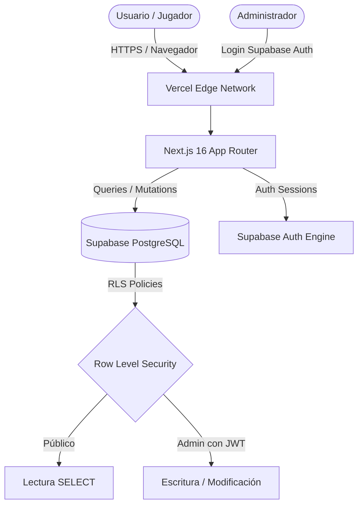

# Manual Integral del Sistema - R.D Eventos

> **Documento Técnico y Operativo Exclusivo**  
> **Plataforma:** Circuito R.D Eventos  
> **Dominio de Producción:** [https://www.rdeventos.online](https://www.rdeventos.online)  
> **Repositorio:** [github.com/thxlopez7/black-padel](https://github.com/thxlopez7/black-padel)  
> **Fecha de Consolidación:** Octubre 2026  

---

## Índice General

1. [Visión General del Proyecto](#1-visión-general-del-proyecto)
2. [Arquitectura Tecnológica y Stack](#2-arquitectura-tecnológica-y-stack)
3. [Estructura del Proyecto y Archivos](#3-estructura-del-proyecto-y-archivos)
4. [Base de Datos (Supabase PostgreSQL)](#4-base-de-datos-supabase-postgresql)
   - [Esquema de Tablas](#esquema-de-tablas)
   - [Seguridad Row-Level Security (RLS)](#seguridad-row-level-security-rls)
5. [Módulos y Funcionalidades del Sistema](#5-módulos-y-funcionalidades-del-sistema)
   - [5.1. Vista Pública (Jugadores y Espectadores)](#51-vista-pública-jugadores-y-espectadores)
   - [5.2. Autenticación y Seguridad Administrativa](#52-autenticación-y-seguridad-administrativa)
   - [5.3. Gestión de Categorías e Inscripciones](#53-gestión-de-categorías-e-inscripciones)
   - [5.4. Control de Pagos](#54-control-de-pagos)
   - [5.5. Generación de Torneos](#55-generación-de-torneos)
   - [5.6. Resultados y Edición del Fixture](#56-resultados-y-edición-del-fixture)
   - [5.7. Progresión de Llaves y Puntajes](#57-progresión-de-llaves-y-puntajes)
   - [5.8. Gestor de Horarios](#58-gestor-de-horarios)
6. [Parámetros de Seguridad y Rendimiento Implementados](#6-parámetros-de-seguridad-y-rendimiento-implementados)
7. [Despliegue, Dominio y Configuración de Producción](#7-despliegue-dominio-y-configuración-de-producción)
8. [Guía Operativa para Administradores](#8-guía-operativa-para-administradores)
9. [Resolución de Problemas (Troubleshooting)](#9-resolución-de-problemas-troubleshooting)

---

## 1. Visión General del Proyecto

**R.D Eventos** es una plataforma web moderna, orientada a dispositivos móviles (*mobile-first*), diseñada para administrar íntegramente torneos de pádel. Permite a los organizadores planificar categorías, gestionar parejas, controlar cobros de inscripciones, sortear cuadros, calendarizar partidos y actualizar resultados en tiempo real con propagación automática de ganadores.

Para el público y jugadores, ofrece una interfaz rápida, limpia y sobria para consultar horarios, canchas y el avance de los cuadros en vivo sin necesidad de registrarse.

---

## 2. Arquitectura Tecnológica y Stack



- **Framework Web:** [Next.js 16 (Turbopack)](https://nextjs.org/) con React 19.
- **Renderizado:** Arquitectura híbrida (Server Component para extracción inicial rápida sin caché obsoleta `revalidate = 0` + Client Components interactivos en tiempo real).
- **Estilos y Diseño:** [Tailwind CSS v4](https://tailwindcss.com/) complementado con fuentes optimizadas de Google Fonts (`Montserrat` para lectura general y `Oswald` para encabezados deportivos).
- **Base de Datos y Backend:** [Supabase](https://supabase.com/) (PostgreSQL administrado con conexión TLS 1.3).
- **Autenticación:** Supabase Auth nativo con JWT y persistencia en sesión segura del cliente.
- **Alojamiento:** [Vercel](https://vercel.com/) con integración directa a GitHub CI/CD y dominio SSL gestionado.

---

## 3. Estructura del Proyecto y Archivos

El repositorio ha sido depurado de código legado y archivos huérfanos. La estructura exacta es:

```text
black-padel/
├── .vscode/
│   └── settings.json             # Ajustes de entorno en editor
├── public/
│   ├── flyer.png                 # Flyer publicitario oficial del torneo
│   ├── RD.jpeg                   # Logo oficial de R.D Eventos
│   └── wallpaper_tapia.jpg       # Fondo institucional con blur
├── src/
│   ├── app/
│   │   ├── favicon.ico           # Favicon del navegador
│   │   ├── globals.css           # Tokens de diseño, Tailwind y animaciones
│   │   ├── layout.js             # Layout raíz, metadataBase y OpenGraph
│   │   └── page.js               # Página principal (Server Component)
│   ├── components/
│   │   ├── AdminLogin.js                # Modal de login de administrador
│   │   ├── AdminPayments.js             # Panel de control de pagos
│   │   ├── AdminPlayers.js              # Gestión de parejas y categorías
│   │   ├── AmericanoView.js             # Tabla de posiciones, fechas, semifinales y final del americano
│   │   ├── BracketView.js               # Zonas y cuadro eliminatorio (formato tradicional)
│   │   ├── CourtSchedule.js             # Cronograma público por cancha
│   │   ├── FixtureView.js               # Fixture público por día y horario, con búsqueda de jugador
│   │   ├── MatchEditorModal.js          # Carga de resultados y edición de cruces y horarios
│   │   ├── TournamentApp.js             # Orquestador principal, panel admin y gestor de horarios
│   │   └── UIComponents.js              # Modales, avisos y nombre de pareja
│   └── lib/
│       ├── format.js             # Formato de fechas y horarios
│       ├── supabase.js           # Inicialización del cliente Supabase
│       ├── supabaseService.js    # Capa de datos, consultas y sanitización defensiva
│       └── tournamentLogic.js    # Motor de llaves, puntajes y propagación
├── supabase/
│   └── security_rls_setup.sql    # Script SQL de seguridad Row-Level Security
├── .env.local                    # Variables de entorno locales (IGNORADO EN GIT)
├── .gitignore                    # Reglas estrictas de exclusión de secretos
├── AGENTS.md                     # Reglas de Next.js
├── eslint.config.mjs             # Configuración del linter
├── jsconfig.json                 # Configuración de resolución de módulos
├── next.config.mjs               # Cabeceras de seguridad OWASP y build flags
├── package.json                  # Dependencias y scripts de ejecución
├── postcss.config.mjs            # Configuración de PostCSS para Tailwind
└── README.md                     # Documentación principal del repositorio
```

---

## 4. Base de Datos (Supabase PostgreSQL)

### Esquema de Tablas

#### 1. `categories`
- `id` (uuid), `name` (text), `num_pairs` (integer): parejas del torneo generado.
- `current_step` (text): `registration` (sin sorteo), `bracket` (tradicional) o `americano`.
- `created_at` (timestamptz).

#### 2. `courts`
- `id` (uuid), `name` (text), `created_at` (timestamptz).

#### 3. `players` (una fila por pareja)
- `id` (uuid), `category_id` (uuid, FK a `categories`, borrado en cascada).
- `name` (text): jugador 1. `partner` (text): jugador 2. En el cuadro la pareja figura como `"name & partner"`.
- `has_paid` (boolean), `created_at` (timestamptz).

#### 4. `matches`
- `id` (uuid), `category_id` (uuid, FK en cascada), `court_id` (uuid, FK, `null` si se borra la cancha).
- `match_type` (text): `ZONE`, `BRACKET`, `AMERICANO`, `AMERICANO_SEMI` o `AMERICANO_FINAL`.
- `round_name` (text), `round_index` (integer), `match_index` (integer): ubicación dentro del cuadro.
- `p1_name`, `p2_name` (text): pareja, `BYE` (pase libre) o lugar por definir (`Zona A 1º`, `1º Tabla Americano`, `Ganador Semifinal 1`).
- `p1_score`, `p2_score` (jsonb): games por set, `["6","4",""]`.
- `winner` (text), `is_wo` (boolean), `is_bye` (boolean).
- `match_date` (date), `match_time` (time).

### Seguridad Row-Level Security (RLS)

El script [supabase/security_rls_setup.sql](supabase/security_rls_setup.sql) aplica políticas RLS en todas las tablas para garantizar que:
1. **El público general y los jugadores anónimos:** Tienen permiso exclusivo de **LECTURA (`SELECT`)** con la clave pública anónima (`anon key`).
2. **Cualquier intento de modificación no autorizado:** (`INSERT`, `UPDATE`, `DELETE`) es rechazado directamente por PostgreSQL con error `42501 (permission denied)`.
3. **El administrador:** Solo tras iniciar sesión válidamente con Supabase Auth obtiene el rol `authenticated` mediante su token JWT, permitiéndole crear, editar y eliminar registros sin restricciones.

---

## 5. Módulos y Funcionalidades del Sistema

### 5.1. Vista Pública (Jugadores y Espectadores)
- **Acceso Directo:** Sin pantallas de login obligatorias ni pasos previos.
- **Selector de Categorías:** Pestañas superiores para alternar al instante entre categorías.
- **Navegación de Modos:**
  1. **Cuadros (Brackets):** Visualiza los cruces por rondas conectadas y resultados.
  2. **Cronograma por Canchas:** Muestra los partidos programados ordenados cronológicamente por cancha.
  3. **Flyer / Información:** Presenta el flyer del torneo y detalles informativos.
- **Actualización Reactiva:** Si el administrador carga un resultado o modifica un horario, la interfaz se refresca automáticamente.

---

### 5.2. Autenticación y Seguridad Administrativa
- **Acceso:** Botón con icono de candado en la barra superior.
- **Formulario:** `AdminLogin.js` solicita correo (`admin@rdeventos.com`) y contraseña.
- **Sesión Persistente:** Supabase Auth mantiene la sesión activa en el navegador; al recargar la página, el estado de administrador se conserva.
- **Cierre de Sesión:** Botón de salir visible en la barra superior cuando se está autenticado.

---

### 5.3. Gestión de Categorías e Inscripciones
- **Panel `AdminPlayers.js`:**
  - Crear nuevas categorías con asignación de género y formato.
  - Inscribir parejas con nombre de ambos integrantes y números de teléfono.
  - Eliminar parejas o categorías completas.
  - Conteo dinámico de parejas anotadas y cálculo de estructura sugerida.

---

### 5.4. Control de Pagos
- **Panel `AdminPayments.js`:**
  - Vista consolidada de todas las parejas inscritas divididas por categoría.
  - Interruptor (*toggle*) inmediato de un clic para marcar: **Pagado** / **Pendiente**.
  - Tarjetas de resumen en tiempo real:
    - Total de parejas inscritas.
    - Parejas con pago confirmado.
    - Parejas con pago pendiente.
    - Porcentaje de recaudación sobre el total.

---

### 5.5. Generación de Torneos
- **Configurar torneo** (por categoría) toma las parejas inscriptas y permite elegir el formato:
  1. **Americano:** todos contra todos (3 puntos por victoria). Al terminar las fechas: semifinales 1º vs 2º y 3º vs 4º, y final entre los ganadores (con 3 parejas, final directa). Desempate: resultado entre sí (dos empatadas), diferencia de sets, diferencia de games y games a favor. W.O. = 6-0 6-0.
  2. **Tradicional:** zonas de 2 parejas (ganador y perdedor pasan al cuadro) y cuadro eliminatorio. Con cantidad impar, una zona tiene pase libre (BYE).
- **Sorteo general:** genera las categorías sin torneo (menos de 6 parejas: americano). Nunca reemplaza uno existente.
- **Pareja de último momento:** desde Configurar torneo, "Agregar al torneo". Americano: juega contra todas en las fechas en que el rival descansa. Tradicional: ocupa un pase libre o se agrega una zona. Los horarios se reacomodan en cascada sin tocar lo jugado.

---

### 5.6. Resultados y Edición del Fixture
- El ganador se calcula desde el marcador (1 set, pro-set o 2 de 3) o por W.O. Se rechazan sets incompletos o empatados.
- Todos los partidos se abren, incluso los de pase libre (horario). En las zonas se pueden cambiar las parejas: si se elige una de otra zona, se intercambian.
- En el americano, los cruces sin jugar se pueden cambiar (se bloquean cruces repetidos).
- Avisos de cancha ocupada o jugador con otro partido a la misma hora (en cualquier categoría).
- Renombrar una pareja ya sorteada actualiza su cuadro; no se puede mover de categoría.

---

### 5.7. Progresión de Llaves y Puntajes
`resolveCategoryMatches` (`src/lib/tournamentLogic.js`) recalcula una categoría con cada resultado, siempre por separado de las demás:
- Ganadores y segundos de zona pasan al cuadro; contra un BYE se avanza solo.
- Si se corrige o borra un resultado, se actualizan las rondas siguientes y se borran los resultados que ya no corresponden.
- Americano: las semis se arman al jugarse todas las fechas y la final al cerrarse las semis.

---

### 5.8. Gestor de Horarios
- Plantilla viernes a domingo (vie 19-00, sáb 10-00, dom 10-19 para semis y finales). Cada jornada define qué instancias admite y un **tope de partidos** opcional.
- Programa las categorías elegidas sin tocar las demás; los partidos jugados no se mueven.
- Un jugador nunca juega dos partidos a la vez, aunque esté en varias categorías; descanso mínimo configurable.
- Cada ronda empieza cuando terminó la anterior. Si una instancia no entra en sus jornadas, usa el primer turno libre de otra y lo informa.
- Resumen previo por categoría antes de guardar.

## 6. Parámetros de Seguridad y Rendimiento Implementados

| Parámetro | Estado | Implementación Técnica |
| :--- | :--- | :--- |
| **Row-Level Security (RLS)** | Activo | Políticas en PostgreSQL que bloquean escrituras no autorizadas (`error 42501`) y permiten lectura pública. |
| **Cabeceras HTTP OWASP** | Activo | Configurado en `next.config.mjs`: `Strict-Transport-Security`, `X-Frame-Options: SAMEORIGIN`, `X-Content-Type-Options: nosniff`, `Referrer-Policy: strict-origin-when-cross-origin`, `Permissions-Policy`. |
| **Ocultamiento de Tecnología** | Activo | `poweredByHeader: false` en Next.js (elimina la cabecera `X-Powered-By: Next.js`). |
| **Validación de datos** | Activo | Marcadores, nombres y cruces se validan en `tournamentLogic.js` antes de guardar; React escapa todo el texto que se muestra. |
| **Exclusión de Secretos en Git** | Activo | `.gitignore` blindado para excluir `.env`, `.env*.local`, claves privadas `.pem`, `.key`, `.cert`. Ningún secreto figura en el historial de Git. |
| **Caché en Tiempo Real** | Activo | `export const revalidate = 0` en `page.js` para asegurar que las consultas del público siempre reflejen los datos actuales de Supabase. |
| **Optimización de Assets** | Activo | Limpieza de 17 archivos obsoletos. Únicamente se sirven imágenes esenciales comprimidas (`RD.jpeg`, `flyer.png`, `wallpaper_tapia.jpg`). |

---

## 7. Despliegue, Dominio y Configuración de Producción

### Dominio Oficial
- **URL Canónica:** [https://www.rdeventos.online](https://www.rdeventos.online)
- **Proveedor de Dominio / DNS:** Vercel Nameservers / Registros A y CNAME configurados hacia `cname.vercel-dns.com`.

### Configuración en Supabase Auth
Para que el inicio de sesión funcione en producción y local, los parámetros en el panel de Supabase (**Authentication > URL Configuration**) son:
- **Site URL:** `https://www.rdeventos.online`
- **Redirect URLs:**
  - `https://www.rdeventos.online/**`
  - `https://rdeventos.online/**`
  - `http://localhost:3000/**` *(vital para desarrollo local)*

### Variables de Entorno en Vercel
En la sección **Settings > Environment Variables** de Vercel, se encuentran cargadas:
- `NEXT_PUBLIC_SUPABASE_URL`: URL del proyecto Supabase.
- `NEXT_PUBLIC_SUPABASE_ANON_KEY`: Llave pública anónima de Supabase.

---

## 8. Guía Operativa para Administradores

### A. Cómo Iniciar Sesión como Administrador
1. Entrar a [https://www.rdeventos.online](https://www.rdeventos.online).
2. Hacer clic en el icono de candado arriba a la derecha.
3. Ingresar el correo del administrador (`admin@rdeventos.com`) y la contraseña.
4. Presionar **Ingresar**. Una vez dentro, se desbloquearán los botones de gestión, piloto automático, edición de partidos y pagos.

### B. Cómo Cargar o Modificar un Resultado
1. En la pestaña **Cuadros**, hacer clic sobre el partido deseado.
2. Ingresar los parciales de los sets (ej: `6-3`, `4-6`, `10-7`).
3. El sistema marcará automáticamente al ganador con la etiqueta verde `✓ Ganador detectado`.
4. Si fue por retiro o ausencia, se puede usar el botón de **W.O.** o seleccionar el ganador manualmente.
5. Hacer clic en **Guardar Resultado**. El ganador avanzará inmediatamente a la siguiente fase en la base de datos.
6. Si necesitas corregir o anular el partido, pulsa **✕ Limpiar Resultado** y se restablecerán las llaves dependientes.

### C. Cómo Marcar Pagos
1. Entrar a la pestaña **Inscripciones y Pagos**.
2. Filtrar por la categoría deseada.
3. Hacer clic en el botón de estado de la pareja para alternar entre **Pagado** y **Pendiente**.

---

## 9. Resolución de Problemas (Troubleshooting)

### 1. El inicio de sesión de admin devuelve "Credenciales inválidas"
- **Causa:** El usuario no está creado en la tabla `auth.users` de Supabase o la contraseña ingresada no coincide.
- **Solución:**
  1. Ir a [supabase.com/dashboard](https://supabase.com/dashboard) > **Authentication** > **Users**.
  2. Verificar que `admin@rdeventos.com` exista y tenga estado confirmado.
  3. Si es necesario, pulsar en los tres puntos (`...`) y seleccionar **Send password reset** o crear un usuario nuevo marcando **Auto Confirm User? = Yes**.

### 2. Error en consola `42501 (permission denied for table ...)` al editar
- **Causa:** La sesión de administrador expiró o el usuario no está autenticado, y las políticas de seguridad RLS bloquearon la escritura.
- **Solución:** Cerrar sesión y volver a ingresar desde el modal de administrador para renovar el token JWT.

### 3. Vercel no refleja el último cambio
- **Causa:** Despliegue en cola o caché de navegador.
- **Solución:**
  1. Verificar en GitHub que el commit esté en la rama `main`.
  2. En el panel de Vercel, revisar el estado de la pestaña **Deployments** (debe figurar en verde *Ready*).
  3. En el navegador, forzar recarga limpia sin caché con `Ctrl + Shift + R` (o `Cmd + Shift + R` en Mac).

---

*Manual generado y verificado para la plataforma deportiva de R.D Eventos.*
