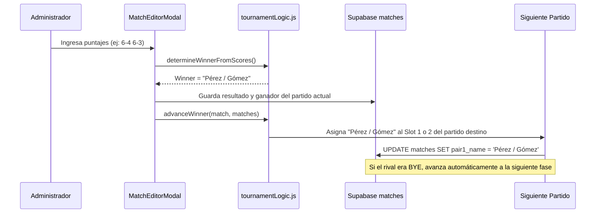

# Manual Integral del Sistema - R.D Eventos

> **Documento Técnico y Operativo Exclusivo**  
> **Plataforma:** Circuito R.D Eventos  
> **Dominio de Producción:** [https://www.rdeventos.online](https://www.rdeventos.online)  
> **Repositorio:** [github.com/thxlopez7/black-padel](https://github.com/thxlopez7/black-padel)  
> **Fecha de Consolidación:** Octubre 2026  

---

## Índice General

1. [Visión General del Proyecto](#1-visión-general-del-proyecto)
2. [Arquitectura Tecnológica y Stack](#2-arquitectura-tecnológica-y-stack)
3. [Estructura del Proyecto y Archivos](#3-estructura-del-proyecto-y-archivos)
4. [Base de Datos (Supabase PostgreSQL)](#4-base-de-datos-supabase-postgresql)
   - [Esquema de Tablas](#esquema-de-tablas)
   - [Seguridad Row-Level Security (RLS)](#seguridad-row-level-security-rls)
5. [Módulos y Funcionalidades del Sistema](#5-módulos-y-funcionalidades-del-sistema)
   - [5.1. Vista Pública (Jugadores y Espectadores)](#51-vista-pública-jugadores-y-espectadores)
   - [5.2. Autenticación y Seguridad Administrativa](#52-autenticación-y-seguridad-administrativa)
   - [5.3. Gestión de Categorías e Inscripciones](#53-gestión-de-categorías-e-inscripciones)
   - [5.4. Control de Pagos](#54-control-de-pagos)
   - [5.5. Piloto Automático (Generación de Cuadros)](#55-piloto-automático-generación-de-cuadros)
   - [5.6. Visualizador y Editor de Cuadros (Brackets)](#56-visualizador-y-editor-de-cuadros-brackets)
   - [5.7. Lógica de Propagación de Llaves y Cálculo de Puntajes](#57-lógica-de-propagación-de-llaves-y-cálculo-de-puntajes)
   - [5.8. Gestor Global de Horarios y Canchas](#58-gestor-global-de-horarios-y-canchas)
6. [Parámetros de Seguridad y Rendimiento Implementados](#6-parámetros-de-seguridad-y-rendimiento-implementados)
7. [Despliegue, Dominio y Configuración de Producción](#7-despliegue-dominio-y-configuración-de-producción)
8. [Guía Operativa para Administradores](#8-guía-operativa-para-administradores)
9. [Resolución de Problemas (Troubleshooting)](#9-resolución-de-problemas-troubleshooting)

---

## 1. Visión General del Proyecto

**R.D Eventos** es una plataforma web moderna, orientada a dispositivos móviles (*mobile-first*), diseñada para administrar íntegramente torneos de pádel. Permite a los organizadores planificar categorías, gestionar parejas, controlar cobros de inscripciones, sortear cuadros, calendarizar partidos y actualizar resultados en tiempo real con propagación automática de ganadores.

Para el público y jugadores, ofrece una interfaz rápida, limpia y sobria para consultar horarios, canchas y el avance de los cuadros en vivo sin necesidad de registrarse.

---

## 2. Arquitectura Tecnológica y Stack


- **Framework Web:** [Next.js 16 (Turbopack)](https://nextjs.org/) con React 19.
- **Renderizado:** Arquitectura híbrida (Server Component para extracción inicial rápida sin caché obsoleta `revalidate = 0` + Client Components interactivos en tiempo real).
- **Estilos y Diseño:** [Tailwind CSS v4](https://tailwindcss.com/) complementado con fuentes optimizadas de Google Fonts (`Montserrat` para lectura general y `Oswald` para encabezados deportivos).
- **Base de Datos y Backend:** [Supabase](https://supabase.com/) (PostgreSQL administrado con conexión TLS 1.3).
- **Autenticación:** Supabase Auth nativo con JWT y persistencia en sesión segura del cliente.
- **Alojamiento:** [Vercel](https://vercel.com/) con integración directa a GitHub CI/CD y dominio SSL gestionado.

---

## 3. Estructura del Proyecto y Archivos

El repositorio ha sido depurado de código legado y archivos huérfanos. La estructura exacta es:

```text
black-padel/
├── .vscode/
│   └── settings.json             # Ajustes de entorno en editor
├── public/
│   ├── flyer.png                 # Flyer publicitario oficial del torneo
│   ├── RD.jpeg                   # Logo oficial de R.D Eventos
│   └── wallpaper_tapia.jpg       # Fondo institucional con blur
├── src/
│   ├── app/
│   │   ├── favicon.ico           # Favicon del navegador
│   │   ├── globals.css           # Tokens de diseño, Tailwind y animaciones
│   │   ├── layout.js             # Layout raíz, metadataBase y OpenGraph
│   │   └── page.js               # Página principal (Server Component)
│   ├── components/
│   │   ├── AddPairToDrawModal.js        # Modal para insertar parejas a llaves
│   │   ├── AdminGlobalScheduleSetup.js  # Gestor maestro de horarios y canchas
│   │   ├── AdminLogin.js                # Modal de login de administrador
│   │   ├── AdminPayments.js             # Panel de control de pagos
│   │   ├── AdminPlayers.js              # Gestión de parejas y categorías
│   │   ├── AutoPilotModal.js            # Asistente de generación automática
│   │   ├── BracketView.js               # Visualizador de cuadro y editor de sets
│   │   ├── CourtSchedule.js             # Cronograma público por canchas
│   │   ├── SwapPairsModal.js            # Modal para permutar parejas en llaves
│   │   ├── TournamentApp.js             # Orquestador principal y estado global
│   │   └── UIComponents.js              # Modales de confirmación y toasts
│   └── lib/
│       ├── supabase.js           # Inicialización del cliente Supabase
│       ├── supabaseService.js    # Capa de datos, consultas y sanitización defensiva
│       └── tournamentLogic.js    # Motor de llaves, puntajes y propagación
├── supabase/
│   └── security_rls_setup.sql    # Script SQL de seguridad Row-Level Security
├── .env.local                    # Variables de entorno locales (IGNORADO EN GIT)
├── .gitignore                    # Reglas estrictas de exclusión de secretos
├── AGENTS.md                     # Reglas de Next.js
├── eslint.config.mjs             # Configuración del linter
├── jsconfig.json                 # Configuración de resolución de módulos
├── next.config.mjs               # Cabeceras de seguridad OWASP y build flags
├── package.json                  # Dependencias y scripts de ejecución
├── postcss.config.mjs            # Configuración de PostCSS para Tailwind
└── README.md                     # Documentación principal del repositorio
```

---

## 4. Base de Datos (Supabase PostgreSQL)

### Esquema de Tablas

#### 1. `categories`
Almacena las divisiones o categorías del torneo (ej: "4ta Caballeros", "6ta Damas", "Suma 11").
- `id` (text / uuid): Identificador único.
- `name` (text): Nombre visible de la categoría.
- `gender` (text): Género ('Caballeros', 'Damas', 'Mixto').
- `active` (boolean): Indica si la categoría está activa para visualización.
- `bracket_type` (text): Tipo de formato ('groups_playoffs', 'direct_elimination').

#### 2. `courts`
Define las canchas disponibles para la disputa de partidos.
- `id` (text / uuid): Identificador único.
- `name` (text): Nombre de la cancha (ej: "Cancha 1", "Cancha Central").
- `active` (boolean): Si está habilitada para programar partidos.
- `order_index` (integer): Orden secuencial en el gestor y vistas públicas.

#### 3. `players`
Registra las parejas inscritas en cada categoría.
- `id` (text / uuid): Identificador único.
- `category_id` (text / uuid): Llave foránea a `categories`.
- `pair_name` (text): Nombre identificador de la pareja (ej: "Pérez / González").
- `player1_name` (text): Nombre del jugador 1.
- `player2_name` (text): Nombre del jugador 2.
- `player1_phone` (text): Teléfono de contacto.
- `player2_phone` (text): Teléfono de contacto.
- `paid` (boolean): Estado del pago de inscripción.
- `seed` (integer): Cabeza de serie (1, 2, 3...) o null.

#### 4. `matches`
Es el núcleo del fixture y los cuadros eliminatorios.
- `id` (text / uuid): Identificador único del partido.
- `category_id` (text / uuid): Llave foránea a `categories`.
- `court_id` (text / uuid): Cancha asignada (nullable).
- `stage` (text): Etapa ('group', 'playoff', 'consolacion').
- `round` (text): Nombre de la fase ('Zona A', 'Octavos', 'Cuartos', 'Semifinales', 'Final').
- `match_number` (integer): Posición secuencial del partido dentro de la ronda.
- `pair1_name` (text): Nombre de la primera pareja o marcador 'BYE'.
- `pair2_name` (text): Nombre de la segunda pareja o marcador 'BYE'.
- `score` (text): Resultado en texto (ej: "6-4 3-6 10-7").
- `winner` (text): Nombre de la pareja que ganó el partido (o null si está pendiente).
- `match_time` (text): Hora del encuentro (formato "HH:mm").
- `match_date` (text): Día o fecha asignada (ej: "Viernes", "2026-10-15").
- `is_bye` (boolean): `true` si una de las plazas avanza automáticamente sin jugar.
- `next_match_id` (text / uuid): Referencia al partido siguiente hacia el cual avanza el ganador.
- `slot` (integer): Ranura de destino en el siguiente partido (1 para `pair1_name`, 2 para `pair2_name`).

---

### Seguridad Row-Level Security (RLS)

El script [supabase/security_rls_setup.sql](file:///home/thiagol/black-padel/supabase/security_rls_setup.sql) aplica políticas RLS en todas las tablas para garantizar que:
1. **El público general y los jugadores anónimos:** Tienen permiso exclusivo de **LECTURA (`SELECT`)** con la clave pública anónima (`anon key`).
2. **Cualquier intento de modificación no autorizado:** (`INSERT`, `UPDATE`, `DELETE`) es rechazado directamente por PostgreSQL con error `42501 (permission denied)`.
3. **El administrador:** Solo tras iniciar sesión válidamente con Supabase Auth obtiene el rol `authenticated` mediante su token JWT, permitiéndole crear, editar y eliminar registros sin restricciones.

---

## 5. Módulos y Funcionalidades del Sistema

### 5.1. Vista Pública (Jugadores y Espectadores)
- **Acceso Directo:** Sin pantallas de login obligatorias ni pasos previos.
- **Selector de Categorías:** Pestañas superiores para alternar al instante entre categorías.
- **Navegación de Modos:**
  1. **Cuadros (Brackets):** Visualiza los cruces por rondas conectadas y resultados.
  2. **Cronograma por Canchas:** Muestra los partidos programados ordenados cronológicamente por cancha.
  3. **Flyer / Información:** Presenta el flyer del torneo y detalles informativos.
- **Actualización Reactiva:** Si el administrador carga un resultado o modifica un horario, la interfaz se refresca automáticamente.

---

### 5.2. Autenticación y Seguridad Administrativa
- **Acceso:** Botón con icono de candado en la barra superior.
- **Formulario:** `AdminLogin.js` solicita correo (`admin@rdeventos.com`) y contraseña.
- **Sesión Persistente:** Supabase Auth mantiene la sesión activa en el navegador; al recargar la página, el estado de administrador se conserva.
- **Cierre de Sesión:** Botón de salir visible en la barra superior cuando se está autenticado.

---

### 5.3. Gestión de Categorías e Inscripciones
- **Panel `AdminPlayers.js`:**
  - Crear nuevas categorías con asignación de género y formato.
  - Inscribir parejas con nombre de ambos integrantes y números de teléfono.
  - Eliminar parejas o categorías completas.
  - Conteo dinámico de parejas anotadas y cálculo de estructura sugerida.

---

### 5.4. Control de Pagos
- **Panel `AdminPayments.js`:**
  - Vista consolidada de todas las parejas inscritas divididas por categoría.
  - Interruptor (*toggle*) inmediato de un clic para marcar: **Pagado** / **Pendiente**.
  - Tarjetas de resumen en tiempo real:
    - Total de parejas inscritas.
    - Parejas con pago confirmado.
    - Parejas con pago pendiente.
    - Porcentaje de recaudación sobre el total.

---

### 5.5. Piloto Automático (Generación de Cuadros)
- **Modal `AutoPilotModal.js`:**
  - Permite sortear automáticamente todo el torneo para una categoría con un solo clic.
  - Admite dos formatos:
    1. **Fase de Zonas + Llaves:** Agrupa las parejas en zonas de 3 o 4 equipos (todos contra todos) y genera automáticamente los cruces eliminatorios de los clasificados.
    2. **Eliminación Directa:** Estructura llaves automáticas para cualquier número de parejas (4, 8, 16, etc.) asignando *BYEs* estratégicamente para completar potencias de 2.

---

### 5.6. Visualizador y Editor de Cuadros (Brackets)
- **Componente `BracketView.js`:**
  - Renderizado responsivo de rondas (Zonas, Octavos, Cuartos, Semifinales, Final).
  - Filtro por rondas para enfocar la pantalla en la fase deseada sin desplazamientos eternos.
  - Conexiones visuales que indican el trayecto de los ganadores hacia la copa.
  - **Permuta de Parejas (`SwapPairsModal.js`):** Permite al admin intercambiar dos parejas de posición en el cuadro antes de iniciar los partidos sin tener que rehacer el sorteo.
  - **Inserción Manual (`AddPairToDrawModal.js`):** Permite colocar una pareja directamente en una ranura libre del cuadro.

---

### 5.7. Lógica de Propagación de Llaves y Cálculo de Puntajes

El motor implementado en [tournamentLogic.js](file:///home/thiagol/black-padel/src/lib/tournamentLogic.js) resuelve automáticamente la progresión del torneo:

#### A. Detección Inteligente del Ganador (`determineWinnerFromScores`)
Al ingresar los parciales de sets (ej: `Set 1`, `Set 2`, `Set 3`), la función analiza:
- **Al mejor de 3 sets:** Detecta automáticamente si una pareja alcanza 2 sets ganados.
- **Tiebreaks estándar:** Valida marcadores como `7-6` / `6-7` (diferencia mínima o desempate en 7).
- **Super Tiebreak en el 3er Set:** Si el tercer parcial se disputa a 10 puntos (ej: `10-7`, `11-9`), lo computa válidamente como set decisivo.
- **Formato a 1 Set (Fase de Zonas):** Reconoce victorias directas en sets largos a 9 juegos (ej: `9-5`) o estándar a 6 juegos.
- **Parciales Incompletos:** Si el partido está en juego (ej: van `6-4` y `2-3`), no fuerza un ganador prematuro hasta que concluya el encuentro.
- **Indicador en Tiempo Real:** El modal muestra una insignia verde en vivo: `✓ Ganador detectado: [Nombre de la pareja]`.

#### B. Propagación Automática a la Siguiente Ronda (`advanceWinner`)


- **Mapeo Dinámico de Cuadros (`BRACKET_MAPS`):**
  - Cuadros de 16 parejas: Octavos (P1..P8) ➔ Cuartos (P1..P4) ➔ Semifinales (P1..P2) ➔ Final (P1).
  - Cuadros de 8 parejas: Cuartos (P1..P4) ➔ Semifinales (P1..P2) ➔ Final (P1).
  - Cuadros de 4 parejas: Semifinales (P1..P2) ➔ Final (P1).
- **Cascada de BYEs:** Si el ganador avanza a un partido donde el rival es `BYE`, el sistema lo propaga inmediatamente a la siguiente instancia sin intervención manual.
- **Limpieza y Reversión en Cascada:** Si el administrador se equivoca y borra el resultado con el botón **"✕ Limpiar Resultado"** o cambia el ganador:
  - El sistema detecta la modificación.
  - Limpia el nombre del ganador en los partidos siguientes de la cadena.
  - Elimina puntajes cargados en rondas posteriores que dependían de la pareja corregida, evitando inconsistencias en la base de datos.

---

### 5.8. Gestor Global de Horarios y Canchas
- **Componente `AdminGlobalScheduleSetup.js`:**
  - Diseñado con una interfaz sin sobrecarga de texto ni emojis infantiles, utilizando iconos SVG minimalistas.
  - **Detección de Conflictos:** Advierte si una pareja tiene dos partidos asignados en la misma franja horaria.
  - **Margen de Descanso:** Controla que los jugadores tengan tiempo suficiente de descanso entre partidos de zonas y eliminatorias.
  - **Jerarquía de Rondas:** Facilita la asignación de horarios centrales y de mayor concurrencia a las semifinales y finales.
  - **Ajuste Responsivo:** Todas las tarjetas y cajas de horarios cuentan con protección contra desbordamiento (`overflow-hidden`, `text-ellipsis`), impidiendo que el texto se corte o rompa el diseño en pantallas de celulares.

---

## 6. Parámetros de Seguridad y Rendimiento Implementados

| Parámetro | Estado | Implementación Técnica |
| :--- | :--- | :--- |
| **Row-Level Security (RLS)** | Activo | Políticas en PostgreSQL que bloquean escrituras no autorizadas (`error 42501`) y permiten lectura pública. |
| **Cabeceras HTTP OWASP** | Activo | Configurado en `next.config.mjs`: `Strict-Transport-Security`, `X-Frame-Options: SAMEORIGIN`, `X-Content-Type-Options: nosniff`, `Referrer-Policy: strict-origin-when-cross-origin`, `Permissions-Policy`. |
| **Ocultamiento de Tecnología** | Activo | `poweredByHeader: false` en Next.js (elimina la cabecera `X-Powered-By: Next.js`). |
| **Sanitización Defensiva** | Activo | Funciones `sanitizeString` y `sanitizeScores` en `supabaseService.js` que limpian inyecciones HTML/XSS y validan rangos numéricos (0–99). |
| **Exclusión de Secretos en Git** | Activo | `.gitignore` blindado para excluir `.env`, `.env*.local`, claves privadas `.pem`, `.key`, `.cert`. Ningún secreto figura en el historial de Git. |
| **Caché en Tiempo Real** | Activo | `export const revalidate = 0` en `page.js` para asegurar que las consultas del público siempre reflejen los datos actuales de Supabase. |
| **Optimización de Assets** | Activo | Limpieza de 17 archivos obsoletos. Únicamente se sirven imágenes esenciales comprimidas (`RD.jpeg`, `flyer.png`, `wallpaper_tapia.jpg`). |

---

## 7. Despliegue, Dominio y Configuración de Producción

### Dominio Oficial
- **URL Canónica:** [https://www.rdeventos.online](https://www.rdeventos.online)
- **Proveedor de Dominio / DNS:** Vercel Nameservers / Registros A y CNAME configurados hacia `cname.vercel-dns.com`.

### Configuración en Supabase Auth
Para que el inicio de sesión funcione en producción y local, los parámetros en el panel de Supabase (**Authentication > URL Configuration**) son:
- **Site URL:** `https://www.rdeventos.online`
- **Redirect URLs:**
  - `https://www.rdeventos.online/**`
  - `https://rdeventos.online/**`
  - `http://localhost:3000/**` *(vital para desarrollo local)*

### Variables de Entorno en Vercel
En la sección **Settings > Environment Variables** de Vercel, se encuentran cargadas:
- `NEXT_PUBLIC_SUPABASE_URL`: URL del proyecto Supabase.
- `NEXT_PUBLIC_SUPABASE_ANON_KEY`: Llave pública anónima de Supabase.

---

## 8. Guía Operativa para Administradores

### A. Cómo Iniciar Sesión como Administrador
1. Entrar a [https://www.rdeventos.online](https://www.rdeventos.online).
2. Hacer clic en el icono de candado arriba a la derecha.
3. Ingresar el correo del administrador (`admin@rdeventos.com`) y la contraseña.
4. Presionar **Ingresar**. Una vez dentro, se desbloquearán los botones de gestión, piloto automático, edición de partidos y pagos.

### B. Cómo Cargar o Modificar un Resultado
1. En la pestaña **Cuadros**, hacer clic sobre el partido deseado.
2. Ingresar los parciales de los sets (ej: `6-3`, `4-6`, `10-7`).
3. El sistema marcará automáticamente al ganador con la etiqueta verde `✓ Ganador detectado`.
4. Si fue por retiro o ausencia, se puede usar el botón de **W.O.** o seleccionar el ganador manualmente.
5. Hacer clic en **Guardar Resultado**. El ganador avanzará inmediatamente a la siguiente fase en la base de datos.
6. Si necesitas corregir o anular el partido, pulsa **✕ Limpiar Resultado** y se restablecerán las llaves dependientes.

### C. Cómo Marcar Pagos
1. Entrar a la pestaña **Inscripciones y Pagos**.
2. Filtrar por la categoría deseada.
3. Hacer clic en el botón de estado de la pareja para alternar entre **Pagado** y **Pendiente**.

---

## 9. Resolución de Problemas (Troubleshooting)

### 1. El inicio de sesión de admin devuelve "Credenciales inválidas"
- **Causa:** El usuario no está creado en la tabla `auth.users` de Supabase o la contraseña ingresada no coincide.
- **Solución:**
  1. Ir a [supabase.com/dashboard](https://supabase.com/dashboard) > **Authentication** > **Users**.
  2. Verificar que `admin@rdeventos.com` exista y tenga estado confirmado.
  3. Si es necesario, pulsar en los tres puntos (`...`) y seleccionar **Send password reset** o crear un usuario nuevo marcando **Auto Confirm User? = Yes**.

### 2. Error en consola `42501 (permission denied for table ...)` al editar
- **Causa:** La sesión de administrador expiró o el usuario no está autenticado, y las políticas de seguridad RLS bloquearon la escritura.
- **Solución:** Cerrar sesión y volver a ingresar desde el modal de administrador para renovar el token JWT.

### 3. Vercel no refleja el último cambio
- **Causa:** Despliegue en cola o caché de navegador.
- **Solución:**
  1. Verificar en GitHub que el commit esté en la rama `main`.
  2. En el panel de Vercel, revisar el estado de la pestaña **Deployments** (debe figurar en verde *Ready*).
  3. En el navegador, forzar recarga limpia sin caché con `Ctrl + Shift + R` (o `Cmd + Shift + R` en Mac).

---

*Manual generado y verificado para la plataforma deportiva de R.D Eventos.*
